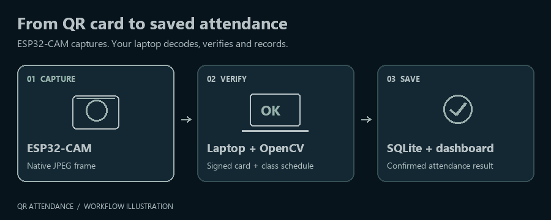
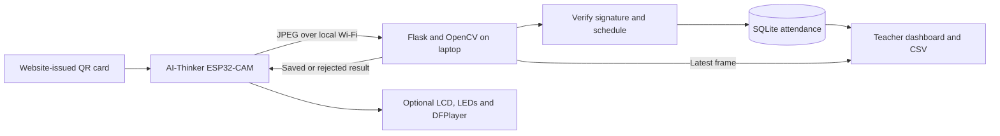
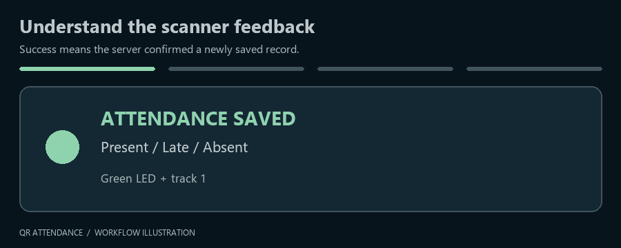
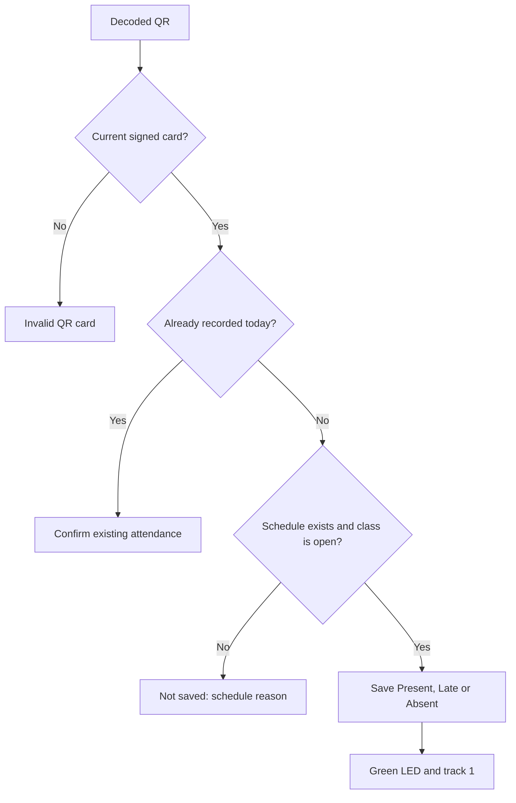

# QR Attendance

**ESP32-CAM QR scanning, a local Flask dashboard, and classroom attendance feedback.**

An AI-Thinker ESP32-CAM captures QR cards and sends JPEG frames over local Wi-Fi. The laptop decodes and verifies each signed card, saves attendance in SQLite, and returns the result. Add a 16x2 LCD, DFPlayer Mini speaker, and separate green/red LEDs when you are ready.



*Animated workflow illustration, not a dashboard recording or scan-speed benchmark.*

[Quick start](#quick-start) · [Firmware](#firmware) · [Wiring](#hardware-and-wiring) · [Class schedule](#class-schedule) · [Troubleshooting](#troubleshooting) · [Technical reference](REFERENCE.md)

## Features

- Student registration, printable signed QR cards, and lost-card replacement that revokes old copies.
- Print-ready A4 PDF sheets for selected students or everyone, with names, signed QR codes, IDs, and an editable message; individual PDF/PNG downloads are also available.
- Multiple classes with separate rosters and multiple sessions per class on the same day.
- One check-in per student per session per Philippine calendar day, with Present, Late, or Absent status.
- Daily start time and optional end time.
- Live camera preview, automatic attendance updates, and CSV export.
- Separate Attendance, Students & QR cards, Calendar, and Absence audit pages.
- Teacher-reviewed daily rosters, corrections with reasons, and fourth-absence QR blocking with teacher overrides.
- Offline operation once dependencies are installed; a reachable local Wi-Fi network is still required.

## How it works



QR decoding runs on the laptop. Scanning continues when the dashboard is closed or preview is stopped. The current firmware uses Espressif's camera driver directly; **ESP32QRCodeReader is not required**.

## Quick start

### Prepare the laptop

The bundled offline installer targets **64-bit Windows with Python 3.13**. Python itself is not bundled.

```powershell
git clone https://github.com/LikeNmuFF/QRAttendance.git
cd QRAttendance
.\install_offline.cmd
.\start.cmd
```

Open [http://localhost:5000](http://localhost:5000), then choose **Open dashboard**.

On first startup, the server generates credentials in `python/instance/config.json`. Sign in as **admin** with that file's `ADMIN_PASSWORD`. Keep the file private. Copy its `ATTENDANCE_TOKEN` into the firmware's `DEVICE_TOKEN` setting.

For online dependency installation instead:

```powershell
python -m venv .venv
.\.venv\Scripts\python.exe -m pip install -r python/requirements.txt
.\start.cmd
```

See the [offline installation guide](offline/README.md) for supported wheels.

### Connect the devices

1. Connect the laptop and ESP32-CAM to the same reachable **2.4 GHz Wi-Fi network** or phone hotspot.
2. Run `ipconfig` on the laptop and find that connection's Wi-Fi IPv4 address.
3. Put it in firmware `SERVER_URL`, for example `http://192.168.1.100:5000/scan`. Replace the example IP with yours.
4. Allow inbound TCP **5000** on your trusted private network. Keep the laptop awake and `start.cmd` running.

`localhost` only reaches the device it is opened on. Some hotspots isolate connected devices. Update the firmware URL if the laptop's IP changes.

## Firmware

In Arduino IDE:

1. Install **esp32 by Espressif Systems** through Boards Manager. The verified build uses **3.2.0**.
2. Install **LiquidCrystal I2C** and **DFRobotDFPlayerMini** through Library Manager.
3. Open [AttendanceCam.ino](firmware/AttendanceCam/AttendanceCam.ino), keeping `config.h` and `camera_pins.h` beside it.
4. Set `WIFI_SSID`, `WIFI_PASSWORD`, `SERVER_URL`, and `DEVICE_TOKEN` in `config.h`. Keep credentials private.
5. Select **AI Thinker ESP32-CAM**, with PSRAM and a suitable large application partition. Start upload speed at **115200**.
6. For manual flashing, connect **GPIO0 to GND**, reset, and upload. Remove GPIO0 from GND and reset to run. Use 3.3 V UART logic and stable 5 V board power.
7. Open Serial Monitor at **115200 baud** to confirm camera and Wi-Fi initialization.

The project uses the AI-Thinker pin map with OV3660/OV2640 support. Physical focus, lighting, power quality, and actual scan reliability need testing on your board.

### First scan

1. Sign in and register a student with an ID and full name.
2. Print their website-issued QR card with its white border intact.
3. Select today's date and save a class schedule that is currently open.
4. Hold the complete QR inside the preview guide, sharply focused and evenly lit.
5. Confirm the saved attendance row. Records update automatically about every two seconds.

You can start with **only the ESP32-CAM**. Missing LCD hardware is detected at startup and LCD commands are skipped; results remain available in Serial Monitor and the dashboard. Power off before adding components, then restart. The documented pins and configured LCD address need no code changes.

## Hardware and wiring

Read the **[detailed assembly README](firmware/AttendanceCam/README.md)** before wiring. Use its matching [wiring checklist](HARDWARE_WIRING.md) and [full wiring diagram](hardware-wiring.svg).

| Component | Connection |
|---|---|
| ESP32-CAM with PSRAM | Stable regulated 5 V supply and common GND |
| 16x2 I2C LCD | GPIO13 SDA / GPIO14 SCL through the documented level shifter when required; default address `0x27` |
| Green LED | GPIO12 -> **330R** -> long leg (+); short leg (-) -> GND |
| GPIO12 pull-down | Separate **10K** from GPIO12 to GND |
| Red LED | GPIO15 -> **330R** -> long leg (+); short leg (-) -> GND |
| DFPlayer Mini | 5 V and common GND; GPIO2 -> **1K** -> RX; **TX unconnected** |
| Passive speaker | Across DFPlayer **SPK1 and SPK2**; neither terminal to GND |

Each LED needs its own 330R resistor. The earlier 470 Ohm value also works for ordinary indicator LEDs. Keep GPIO12's separate 10K pull-down so it stays low during reset. The ESP32-CAM microSD slot is unused because its pins are reused; DFPlayer has its own card.

> [!IMPORTANT]
> Power off before wiring. ESP32 GPIOs are not 5 V tolerant. Remove any old DFPlayer TX-to-GPIO15 wire before adding the red LED. Follow the detailed guide for LCD level shifting and shared power.

### DFPlayer audio

Put actual MP3 recordings in an `mp3` folder on a supported FAT16/FAT32 microSD card in the **DFPlayer**:

| File | Event |
|---|---|
| `mp3/0001.mp3` | Attendance saved: Present, Late, or Absent |
| `mp3/0002.mp3` | Already recorded today |
| `mp3/0003.mp3` | Invalid or revoked QR card |
| `mp3/0004.mp3` | Attendance not saved, including closed class or server failure |

Recordings are not included. Firmware uses 9600-baud TX-only commands and volume 22/30. It cannot verify playback/card presence. Missing audio does not prevent saving attendance. See the [DFPlayer wiring and test steps](firmware/AttendanceCam/README.md#6-connect-the-dfplayer-mini-and-speaker).



*Illustrated result examples. Green confirms a newly saved record, including Late or Absent. Unreadable QR patterns use red without audio; empty scenes are idle.*

## Class schedule

Times use **Philippine time, UTC+08:00**. Set a start time for each date. End time is optional and must be later than start on the same date; overnight sessions are not supported.

| New check-in time | Result |
|---|---|
| No schedule | Not saved: class time unset |
| Before start | Not saved: class not open |
| First 15 minutes | Present |
| 15 minutes through 39 minutes 59 seconds | Late |
| 40 minutes onward, while class is open | Absent |
| At or after end time, when set | Not saved: class ended |



Blank end time means no cutoff. Start locks after the first check-in; end can still be changed or cleared until the teacher finalizes that day. Finalization locks both hours and closes scanning for the date.

### Multiple classes and sessions

1. Restart the server with `start.cmd`.
2. Open **Classes & sessions** and create a class. New classes start with an empty roster and a **Daily session**.
3. Register new students from **Students & QR cards**, or enroll an existing student from **Classes & sessions**. One student can belong to several classes and keeps the same QR card.
4. Add sessions such as **Morning** and **Afternoon**. Use the **Class** and **Session** selectors to open the desired workspace.
5. In **Attendance**, choose the date and save session hours. For today, choose **Use [session] for scanning** before students scan.
6. Review/finalize each session separately from **Calendar**. CSV exports, corrections, and live records use the selected session; absence audits combine that class's sessions.

Browsing another class or session does not switch the scanner. The selection is shared across browser tabs, persists across server restarts, and expires when the date changes. Creating a second class/session clears the original automatic default; choose a session explicitly. The original single-session workflow keeps working until then. No new firmware upload or QR reprint is required for classes/sessions.

On first startup, the upgrade moves the existing register into **Default class / Daily session**, preserving students, schedules, attendance, corrections, teacher decisions, and QR secrets. A populated database gets a one-time `python/attendance.db.pre-classes.bak` recovery copy before the class/session migration. Keep it private. To roll back, stop the server and restore that copy together with the earlier application version.

### Calendar, teacher review, and dropped students

Open **Calendar** and click a date to see the class start/end hours, student roster, recorded scan times, and corrections. Set the day's hours from its Attendance link. After class, review the roster and choose **Finalize attendance**. Missing enrolled students become absent. Today's class requires an end time that has passed; previous dates can be finalized with an optional end time. Future dates cannot be finalized. Finalization is explicit; merely viewing a day never adds absences.

On **Students & QR cards**, select rows and choose **Download selected PDF**, or choose **Download all PDF**. One A4 PDF contains six cards per sheet, each with the student's name, current signed QR code, ID, and the editable **Message on each card** (up to 80 characters). Print on A4 at **100% / Actual size**, then cut along the light outlines. Long names and IDs wrap inside the card. Use a row's **Download PDF** for one card; individual PNG downloads and the print-preview page remain available. The default message is "Present this code at the attendance scanner."

**Select visible students** follows the current search; previously checked students remain selected when hidden by a new search. Downloads preserve existing credentials and dropped status. The earlier ZIP endpoint remains available at `/students/qrcodes.zip`. These web download controls need no firmware update. ReportLab and its dependency are bundled in `offline/wheels`; rerun the offline installer on another PC before starting this version.

Only absences on finalized days count toward the drop rule. On the **fourth** confirmed absence, QR scanning is blocked. The scanner returns HTTP 423; the updated firmware displays **You are dropped** / **See your teacher**, with the red LED and existing failure audio track 4. Reflash the ESP32-CAM to enable this LCD message.

In **Absence audit**, teachers can inspect totals and individual history, **give another chance** to allow scanning, explicitly **drop** a student, or **apply the four-absence rule** again. A chance remains in effect until the teacher changes it. Decisions require a reason and preserve absence totals. Corrections support Present, Late, Absent, or Excused; reasons and old/new statuses are saved. Excused does not count as absent. Correcting a total below four restores scanning unless the teacher explicitly dropped the student.

The existing administrator login manages all classes. Absence totals combine finalized sessions **within each class**, with no automatic semester/month reset. Each missed finalized session counts once; two missed sessions on one date count as two absences. Drop decisions and teacher chances affect only the selected class. New students are eligible from their enrollment date in that class. For existing databases, enrollment starts at the earliest saved attendance date, or the upgrade date if no attendance exists; earlier enrollment dates cannot be inferred. Existing attendance is preserved, including its finalized or provisional review state. Dropped students keep their history and valid card credentials so a teacher can restore access without reprinting.

Remove the card after its result. A five-second same-card cooldown suppresses repeated frame events; another student's card can be processed immediately.

## Troubleshooting

| Symptom | Check |
|---|---|
| `/scan` shows Method Not Allowed in a browser | It is a scanner POST endpoint. Open `/` or `/dashboard` in the browser. |
| Wi-Fi status 1 or 6 | Exact SSID/password, visible 2.4 GHz hotspot, signal, and Serial Monitor disconnect reason. |
| Not saved: Check server | Running server, laptop Wi-Fi IPv4, port 5000, firewall, token, and Serial Monitor HTTP/connection code. |
| Preview unavailable | Camera power/Wi-Fi, reachable server, matching token, and admin sign-in. |
| QR is hard to read | Physical focus, even lighting, no glare, complete border, and a current website-issued card. |
| Upload fails: no serial data | Correct COM port, GPIO0-to-GND upload mode, reset, crossed UART TX/RX, common GND, and stable power. |
| No LCD attached | Updated firmware skips LCD writes. Restart after adding a correctly wired LCD. |
| Saved attendance but no sound | DFPlayer card filenames, GPIO2 -> 1K -> RX, speaker across SPK1/SPK2, GND, and power. |
| Board will not boot after adding LEDs | GPIO12 10K pull-down, polarity, and strapping-pin wiring. Power off before disconnecting added signal wires and retrying. |

More diagnostics and HTTP response details: [technical reference](REFERENCE.md).

## Development and verification

```powershell
.\.venv\Scripts\python.exe -m unittest discover -s python/tests -t python -p 'test_*.py' -v
node python/tests/test_dashboard_live.cjs
node python/tests/test_camera_preview.cjs
```

The class/session, calendar, teacher-audit, and QR-download changes pass **82 Python tests**, dashboard JavaScript checks, and desktop/mobile Chromium checks for navigation, PDF downloads, teacher chances, and day finalization. PDF rendering checks verified pagination, accented/long names, long IDs, and QR decoding from all seven rendered sample cards. The updated firmware compiles for AI Thinker ESP32-CAM on core 3.2.0 (1,043,662 bytes program storage; 55,844 bytes globals). These do not certify physical wiring or scan performance. See [AUDIT.md](AUDIT.md) for earlier hardware verification and limitations.

| Location | Purpose |
|---|---|
| [`firmware/AttendanceCam/`](firmware/AttendanceCam/) | Sketch, camera pins, local configuration and assembly guide |
| [`python/attendance/`](python/attendance/) | Flask, OpenCV decoding, SQLite, templates and static assets |
| [`python/tests/`](python/tests/) | Storage, HTTP, camera transport and JavaScript checks |
| [`offline/`](offline/) | Pinned Windows/Python 3.13 offline package |
| [`REFERENCE.md`](REFERENCE.md) | Detailed setup, endpoints, credentials and network notes |
| [`DESIGN.md`](DESIGN.md) | Interface design notes |

## Deployment limits

Use a **trusted LAN**. Plain HTTP does not encrypt passwords, sessions, frames, or device tokens. Do not expose port 5000 to the internet. Keep local configuration and database backups private.

There is one check-in per student per session per date, no check-out, no offline queue, and no individual teacher accounts. The shared scanner records into one selected session at a time. Signed QR cards prevent altered credentials, but an exact copy of a valid card still works. Supervise scanning when identity matters.

This README uses repository-hosted GIFs and [GitHub-native Mermaid blocks](https://docs.github.com/en/get-started/writing-on-github/working-with-advanced-formatting/creating-diagrams); no JavaScript embed is needed.
